# Wrzesień 1939: polskie pojazdy i battlegroupa dla Steel Division: Normandy 44

Polskie pojazdy pancerne z 1939 r. wymodelowane w Blenderze: dwa warianty czołgu lekkiego 7TP, tankietki TK-3 i TKS, samochody pancerne wz. 28 i wz. 34, samoloty PZL P.11c, PZL.23B Karaś i PZL.37B Łoś, motocykl Sokół 1000 z wózkiem i rkm, armata przeciwpancerna 37 mm wz. 36 oraz ciężarówka Polski Fiat 621L. Do tego wtyczka eksportująca czołgi do formatu gry `.Ase2NdfBin` **bez 3ds Max**.

Projekt leży w `D:\Mod\Wrzesien1939` (do 26 listopada 2026 r. `D:\Mod\7TP`). Mod w grze nazywa się `Mod_Wrzesien1939` (wcześniej `Mod_7TP_Battlegroup`) i dodaje battlegroupę „TOMASZÓW 39” z polskimi jednostkami.

| 7TP jednowieżowy (Bofors 37 mm) | 7TP dwuwieżowy (2 × ckm wz. 30) |
|---|---|
|  |  |

| Tankietka TK-3 (ckm Hotchkiss wz. 25) | Tankietka TKS (ckm Hotchkiss wz. 25) |
|---|---|
|  | 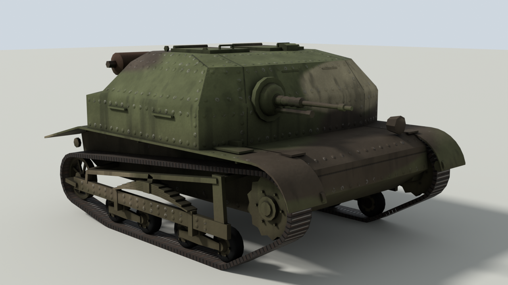 |

| Samochód pancerny wz. 34 (ckm Hotchkiss wz. 25) | Samochód pancerny wz. 34 (armata 37 mm) |
|---|---|
| 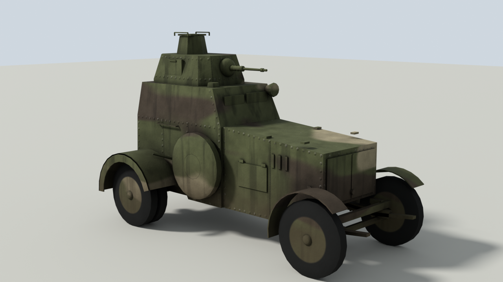 |  |

| Samochód pancerny wz. 28 (ckm Hotchkiss wz. 25) | Samochód pancerny wz. 28 (armata 37 mm) |
|---|---|
|  |  |

| PZL P.11c | PZL P.11c z tyłu |
|---|---|
| 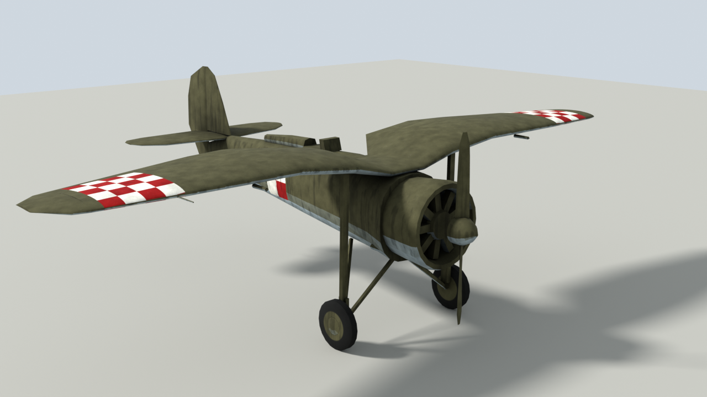 | 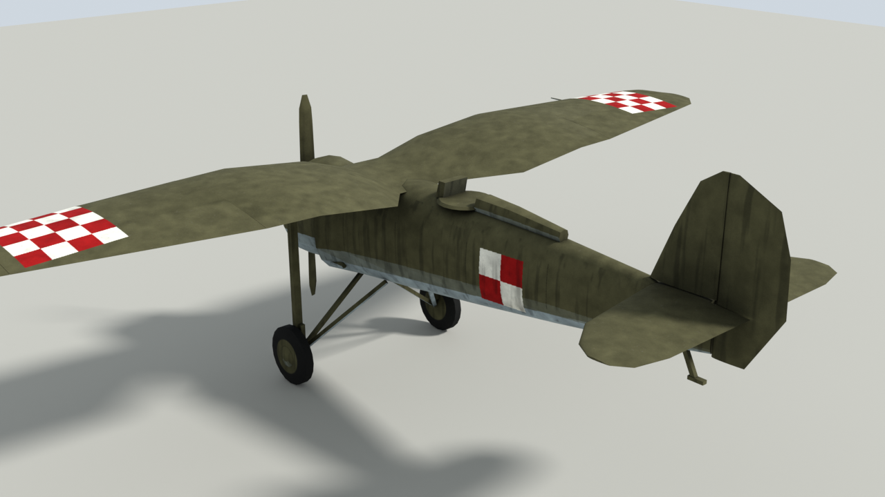 |

| Sokół 1000 z wózkiem i rkm | Sokół 1000 z tyłu |
|---|---|
| 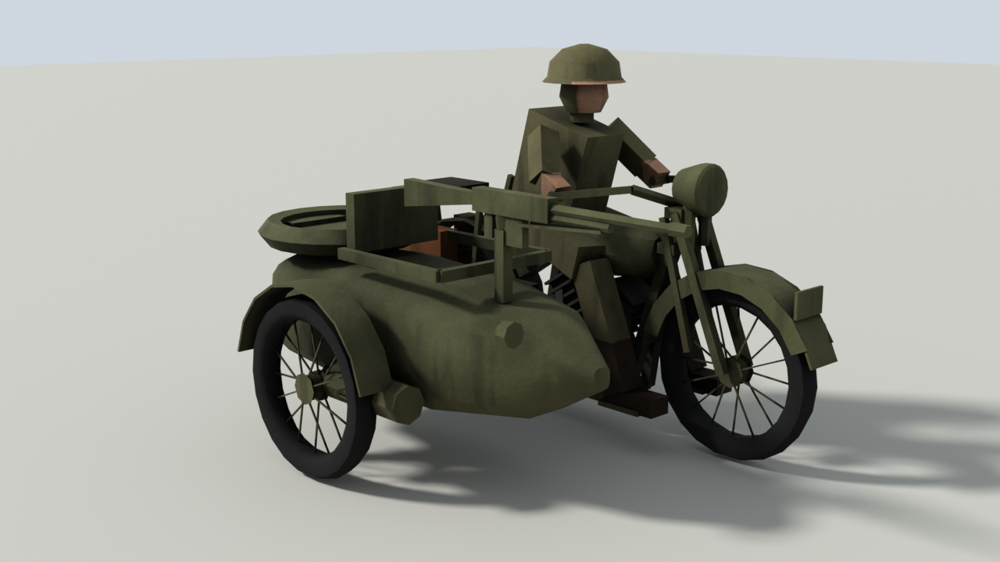 |  |

| PZL.23B Karaś | PZL.37B Łoś |
|---|---|
| 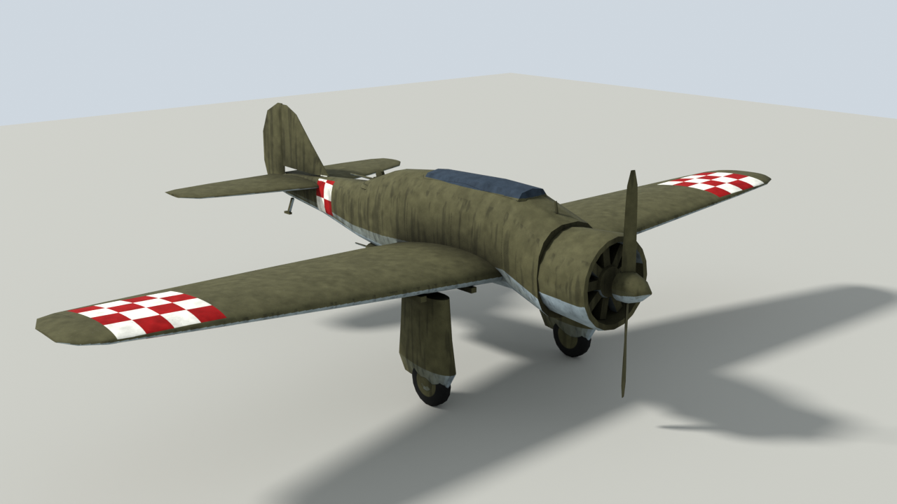 | 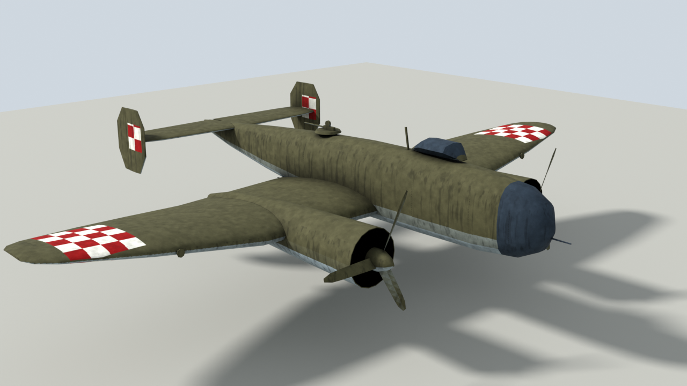 |

| Armata 37 mm wz. 36 (Bofors) | Armata wz. 36 z tyłu |
|---|---|
| 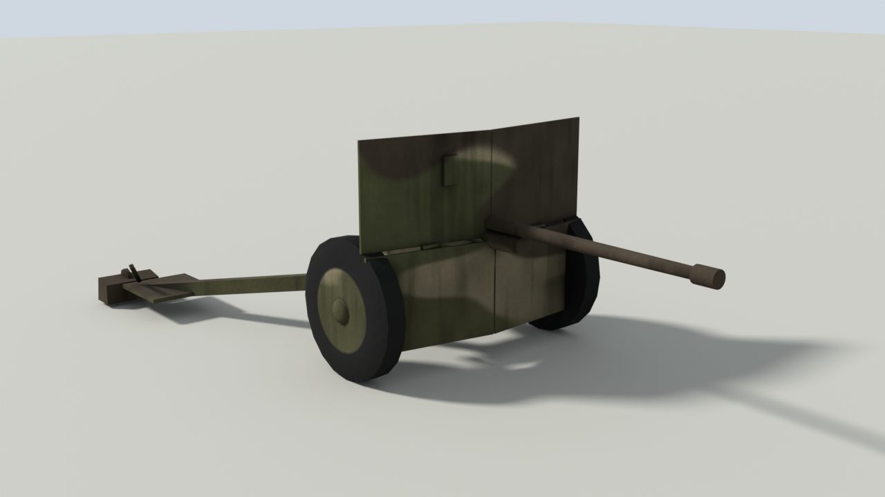 | 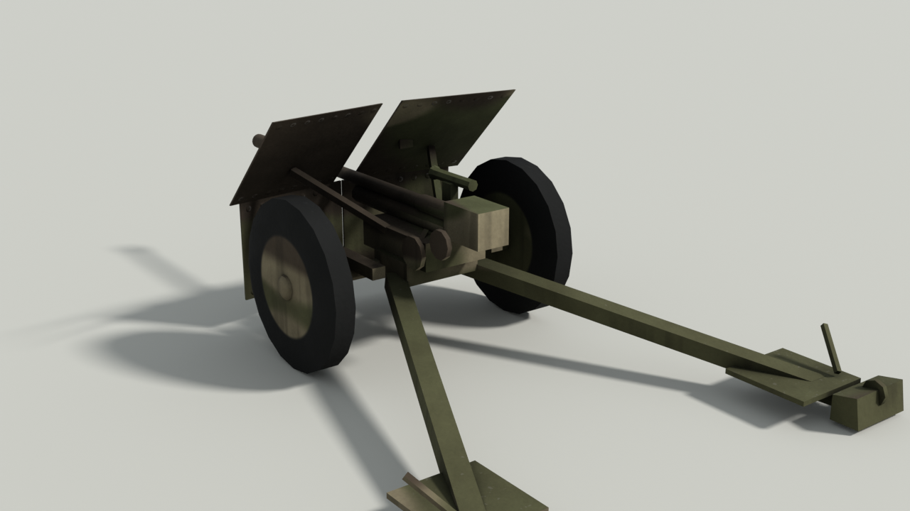 |

| Polski Fiat 621L | Polski Fiat 621L z tyłu |
|---|---|
| 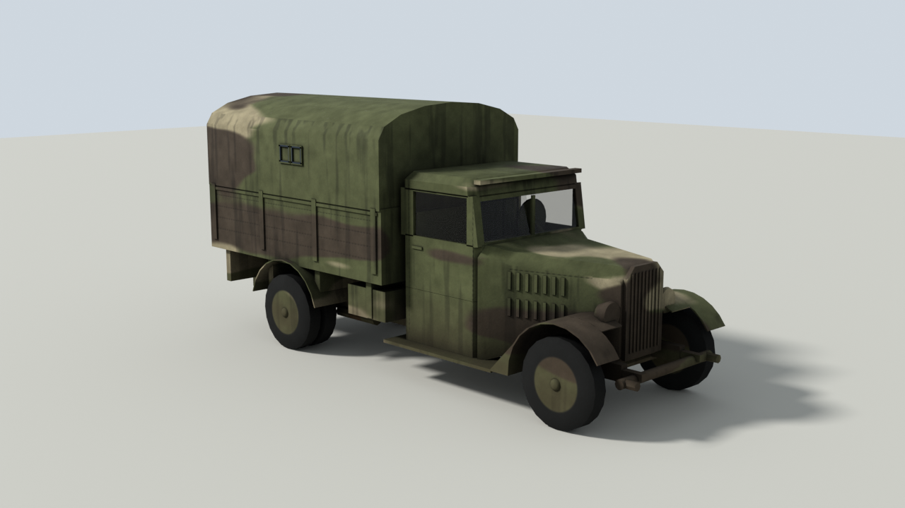 | 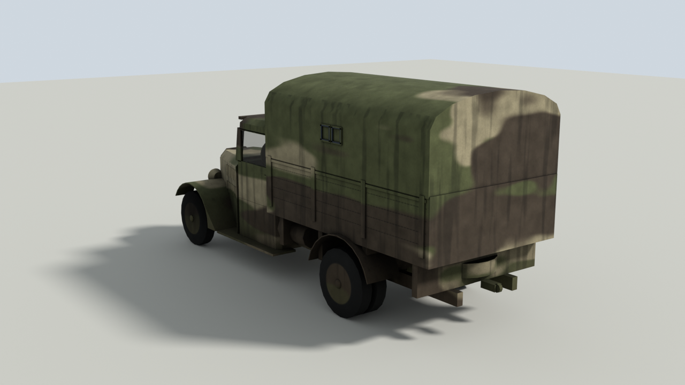 |

## Co jest w projekcie

| Folder | Zawartość |
|---|---|
| [`models/`](models) | 7TP, TK-3, TKS, wz. 28, wz. 34, P.11c, Karaś, Łoś, Sokół 1000, armata wz. 36 i Fiat 621L: pliki `.blend` i `.fbx` w wersjach High, Mid, Low, tekstury i rendery |
| [`blender_addon/`](blender_addon) | Wtyczka do Blendera, gotowa paczka w `dist/` |
| [`scripts/`](scripts) | Skrypty budujące model i tekstury |
| [`docs/`](docs) | Dokumentacja |

## Szybki start

1. Zainstaluj wtyczkę z [`blender_addon/dist`](blender_addon/dist), przeciągając plik `.zip` do okna Blendera.
2. Otwórz model, np. `models/7TP_jednowiezowy_Bofors/TP7_JW.blend`.
3. Wybierz **File > Export > Steel Division Tank (.Ase2NdfBin)**.
4. Dodaj plik do moda według instrukcji [Instalacja w grze](docs/INSTALACJA_W_GRZE.md).

## Dokumentacja

- [Lista modeli](docs/LISTA_MODELI.md)
- [Wtyczka do Blendera](docs/WTYCZKA.md)
- [Instalacja moda Wrzesien1939 jednym skryptem](docs/INSTALACJA_MODA.md)
- [Instalacja w grze (dawny sposób z podmianą Stuarta)](docs/INSTALACJA_W_GRZE.md)
- [Edytor jednostek: napisy i ceny z podglądem](docs/EDYTOR_JEDNOSTEK.md)
- [Ikony jednostek w interfejsie gry](docs/IKONY_JEDNOSTEK.md)
- [Własne grafiki interfejsu: folder graphic](graphic/README.md)
- [Ustawienia jednostek: data/units.toml](docs/USTAWIENIA_JEDNOSTEK.md)
- [Porównanie 7TP z lekkimi czołgami w grze](docs/POROWNANIE_CZOLGOW.md)
- [Model 7TP: wymiary, założenia i ograniczenia](docs/MODEL_7TP.md)
- [Tankietki TK-3 i TKS: wymiary, założenia i ograniczenia](docs/MODEL_TK.md)
- [Samochód pancerny wz. 28](docs/MODEL_WZ28.md)
- [Samochód pancerny wz. 34](docs/MODEL_WZ34.md)
- [Samolot PZL P.11c](docs/MODEL_P11.md)
- [Motocykl Sokół 1000](docs/MODEL_SOKOL.md)
- [Samoloty PZL.23B Karaś i PZL.37B Łoś](docs/MODEL_KARAS_LOS.md)
- [Armata 37 mm wz. 36](docs/MODEL_WZ36.md)
- [Ciężarówka Polski Fiat 621L](docs/MODEL_PF621.md)
- [Piechota w umundurowaniu z 1939 r. (przemalowanie modeli z gry)](docs/PIECHOTA_1939.md)
- [Format Ase2NdfBin](docs/FORMAT_ASE2NDFBIN.md)
- [Przebudowa modelu ze skryptów](docs/BUDOWANIE.md)

## Stan projektu

| Element | Stan |
|---|---|
| Oba modele 7TP w grze, w podglądzie | Sprawdzone |
| Tankietki TK-3 i TKS | Gotowe modele, eksport wtyczką bez błędów, w grze niesprawdzone |
| Samochody pancerne wz. 28 i wz. 34 | Gotowe modele, eksport wtyczką bez błędów, w grze niesprawdzone |
| Samolot PZL P.11c | Gotowy model z plikiem `_train`, eksport wtyczką bez błędów, w grze niesprawdzony |
| Motocykl Sokół 1000 | Gotowy model, eksport wtyczką bez błędów, w grze niesprawdzony |
| Samoloty Karaś i Łoś | Gotowe modele z plikami `_train`, eksport wtyczką bez błędów, w grze niesprawdzone |
| Armata 37 mm wz. 36 | Gotowy model z plikiem `Boites_`, eksport wtyczką bez błędów, w grze niesprawdzony, bez własnych animacji |
| Ciężarówka Polski Fiat 621L | Gotowy model, eksport wtyczką bez błędów, w grze niesprawdzony |
| Wersja jednowieżowa w bitwie | Sprawdzona na wcześniejszej wersji modelu |
| Wózki w grze | Sprawdzone wizualnie |
| Osobne jednostki z własną nazwą i statystykami | Działają w grze (sprawdzone 26 listopada 2026 r.): `Mod_Wrzesien1939` ze skryptu `scripts/create_battlegroup.py` dodaje battlegroupę „TOMASZÓW 39” z 7TP jednowieżowym i dwuwieżowym |
| Ruch wahaczy i resorów | Jeszcze nie ma, są częścią kadłuba |

## Zastrzeżenia

To nieoficjalny projekt fanowski, niezwiązany z Eugen Systems. Repozytorium nie zawiera plików gry ani Modding Assets. Do użycia modeli w grze potrzebna jest własna kopia Steel Division: Normandy 44.

## Licencje

- **Wtyczka** (`blender_addon/`): [GPL-3.0-or-later](blender_addon/LICENSE).
- **Modele, tekstury i rendery** (`models/`): [CC BY-NC 4.0](models/LICENSE). Można je używać, zmieniać i udostępniać w celach niekomercyjnych, z podaniem autora: `wyatt303`, wraz z linkiem do tego repozytorium i informacją o wprowadzonych zmianach.
- **Skrypty i dokumentacja** (`scripts/`, `docs/`, ten plik): wszelkie prawa zastrzeżone. Repozytorium można przeglądać, ale ponowne publikowanie tych plików wymaga zgody autora.
