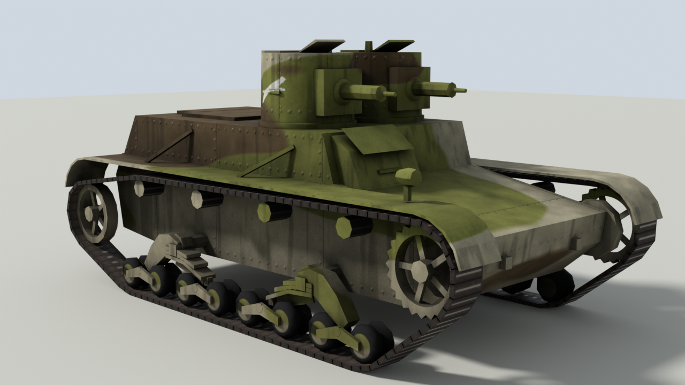

# 7TP dla Steel Division: Normandy 44

Dwa warianty polskiego czołgu lekkiego 7TP, wymodelowane w Blenderze, oraz wtyczka eksportująca czołgi do formatu gry `.Ase2NdfBin` **bez 3ds Max**.

| 7TP jednowieżowy (Bofors 37 mm) | 7TP dwuwieżowy (2 × ckm wz. 30) |
|---|---|
|  |  |

## Co jest w projekcie

| Folder | Zawartość |
|---|---|
| [`models/`](models) | Oba warianty: pliki `.blend` i `.fbx` w wersjach High, Mid, Low, tekstury i rendery |
| [`blender_addon/`](blender_addon) | Wtyczka do Blendera, gotowa paczka w `dist/` |
| [`scripts/`](scripts) | Skrypty budujące model i tekstury |
| [`docs/`](docs) | Dokumentacja |

## Szybki start

1. Zainstaluj wtyczkę z [`blender_addon/dist`](blender_addon/dist), przeciągając plik `.zip` do okna Blendera.
2. Otwórz model, np. `models/7TP_jednowiezowy_Bofors/TP7_JW.blend`.
3. Wybierz **File > Export > Steel Division Tank (.Ase2NdfBin)**.
4. Dodaj plik do moda według instrukcji [Instalacja w grze](docs/INSTALACJA_W_GRZE.md).

## Dokumentacja

- [Wtyczka do Blendera](docs/WTYCZKA.md)
- [Instalacja w grze](docs/INSTALACJA_W_GRZE.md)
- [Model 7TP: wymiary, założenia i ograniczenia](docs/MODEL_7TP.md)
- [Format Ase2NdfBin](docs/FORMAT_ASE2NDFBIN.md)
- [Przebudowa modelu ze skryptów](docs/BUDOWANIE.md)

## Stan projektu

| Element | Stan |
|---|---|
| Oba modele w grze, w podglądzie | Sprawdzone |
| Wersja jednowieżowa w bitwie | Sprawdzona na wcześniejszej wersji modelu |
| Wózki w grze | Sprawdzone wizualnie |
| Osobne jednostki z własną nazwą i statystykami | Jeszcze nie ma, modele zastępują dwa Stuarty M3A3 |
| Ruch wahaczy i resorów | Jeszcze nie ma, są częścią kadłuba |

## Zastrzeżenia

To nieoficjalny projekt fanowski, niezwiązany z Eugen Systems. Repozytorium nie zawiera plików gry ani Modding Assets. Do użycia modeli w grze potrzebna jest własna kopia Steel Division: Normandy 44.

## Licencje

- **Wtyczka** (`blender_addon/`): [GPL-3.0-or-later](blender_addon/LICENSE).
- **Modele, tekstury i rendery** (`models/`): [CC BY-NC 4.0](models/LICENSE). Można je używać, zmieniać i udostępniać w celach niekomercyjnych, z podaniem autora: `wyatt303`, wraz z linkiem do tego repozytorium i informacją o wprowadzonych zmianach.
- **Skrypty i dokumentacja** (`scripts/`, `docs/`, ten plik): wszelkie prawa zastrzeżone. Repozytorium można przeglądać, ale ponowne publikowanie tych plików wymaga zgody autora.
